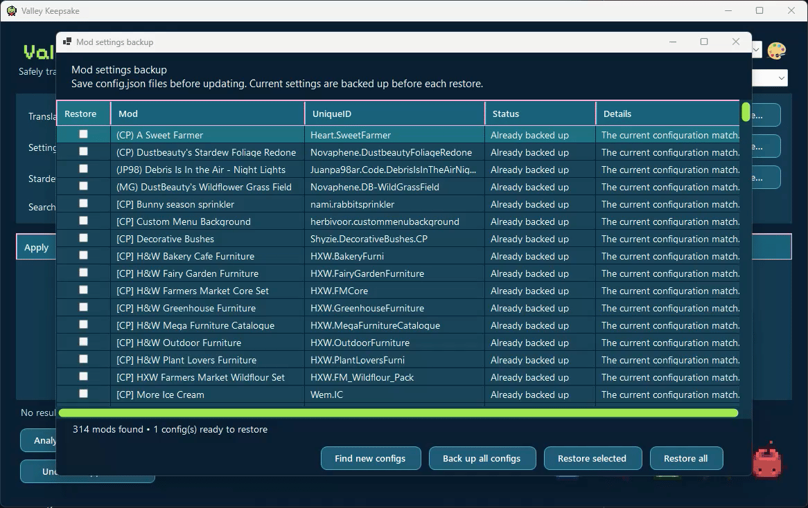

# Valley Keepsake

Valley Keepsake helps Stardew Valley players keep their mod translations and settings when mods are updated or reinstalled. Save translations in your chosen language once, then use the app to find them again instead of downloading the same translations after every update. You can also back up `config.json` files and restore your settings later.

## Quick start

1. Create a folder for your translation library somewhere **outside** the game's `Mods` folder. Choose a folder for settings backups too; it may be inside the translation library or elsewhere.
2. In Valley Keepsake, select those folders under **Translation library** and **Settings library**, then select your Stardew Valley **Mods folder** and the language of the translations you want to save. The app remembers both libraries for the current build. A new build asks you to select them again; the Mods folder may be detected automatically. Changing a library folder does not move existing backups.
3. Click **Find new mods**. The app scans installed mods and copies translations it finds in your selected language into your library. This does not change the installed mods or download missing translations.
4. To save your settings too, open **Settings backup** and click **Back up all configs** on Windows or **Export all settings** on Linux. This is a separate step from **Find new mods**.
5. After updating or reinstalling a mod, click **Analyze**, review any uncertain matches, and use **Apply selected** to transfer saved translations back. Open **Settings backup** to restore selected configs or all missing and changed configs at once.

The app preserves translations already present in your Mods folder. It asks you to review uncertain destinations instead of guessing.

## Compatibility and languages

- Currently, the app is only compatible with Windows, Linux, and SteamOS.
- The app interface is currently available in English and Brazilian Portuguese. However, we have included a folder called “Languages” so that other translation files can be added to the interface.

## Download and install

Download the ready-to-use ZIP for your operating system from the [latest release](https://github.com/SheilaEXE/Valley-Keepsake/releases/latest). The repository folders contain source code, not the ready-to-run application.

- **Windows x64 (PC):** extract the Windows x64 ZIP and open `ValleyKeepsake.exe`.
- **Windows x86 (32-bit, experimental):** extract the Windows x86 ZIP and open `ValleyKeepsake.exe`. The 32-bit package has not yet been tested on a 32-bit Windows installation.
- **Linux x86-64 (including Steam Deck):** extract the Linux ZIP and run `bash install.sh` from the extracted folder. Open Valley Keepsake from your applications menu; a desktop shortcut is also created if a desktop folder exists. Installation is per-user and does not require `sudo`.

If upgrading from Valley Modkeeper on Windows, extract Valley Keepsake into a new folder and launch the new executable. The Linux installer replaces the old app launcher. Select your existing library folders once when opening a new build.

The installer does not install or remove game mods. Check both folder paths in the app before applying translations.

### Optional SMAPI update notices

If you also want SMAPI to report new Valley Keepsake versions when starting Stardew Valley, install the separate **Valley Keepsake Update Notifier** ZIP in your game's `Mods` folder. This companion is optional and works independently of the app's own update prompt. It only points SMAPI to the [Nexus Mods page](https://www.nexusmods.com/stardewvalley/mods/56027); it does not download or install app updates. Its [source and build instructions](Valley-Keepsake-UpdateNotifier/README.md) are included in this repository.

## How it works

The application scans your **translation library** separately from the game's **Mods** folder. A translation may remain listed after its mod is disabled or renamed; an unmatched entry is not installed or applied automatically. It recognizes locale files such as `i18n/es.json`, locale folders such as `i18n/fr/`, selected `assets/Dialogues/<locale>` folders, and supported `content.<locale>.json` text maps. For Portuguese translations, `pt` and `pt-BR` are treated as the same destination language to avoid replacing an existing translation.

Select **en (default)** to save an `en.json` translation and, when present, keep `i18n/default.json` or `i18n/default/` as an English reference. The default reference is not copied for other selected languages and is never applied over a mod's updated default file.

Existing translations in the Mods folder are preserved. The application does not modify installed mods when it scans or imports translations into the library.

---

